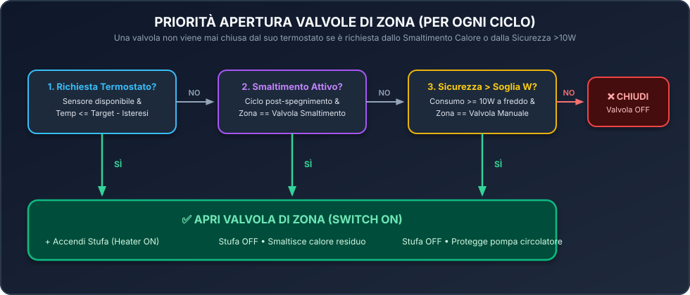

# 🔥 Smart Zone Heating for Home Assistant

[](https://github.com/pasmimmo/ha-smart-zone-heating/actions)
[](https://github.com/pasmimmo/ha-smart-zone-heating/releases)
[](https://www.home-assistant.io/)
[](LICENSE)

🌍 **Language / Lingua:** [**🇮🇹 Italiano**](#-documentazione-in-italiano) | [**🇬🇧 English**](#-english-documentation)

---

# 🇮🇹 Documentazione in Italiano

**Smart Zone Heating** è un'integrazione custom per **Home Assistant** progettata per gestire impianti di riscaldamento multi-zona (es. *Piano 1 / Piano 2*, *Zona Giorno / Zona Notte*, o $N$ stanze) abbinati a qualsiasi generatore di calore (**stufa a pellet**, **termocamino**, **caldaia a biomassa** o **caldaia tradizionale**).

Elimina la necessità di creare decine di `generic_thermostat`, `input_boolean` virtuali, timer e automazioni incrociate, raggruppando l'intero impianto sotto **un unico Dispositivo nativo** di Home Assistant.

---

## 📊 Architettura e Logica di Funzionamento

### 1. Architettura Generale del Sistema


### 2. Macchina a Stati: Riscaldamento, Smaltimento (Watt + Timer Fallback) e Sicurezza


### 3. Priorità Apertura Valvole di Zona


---

## ✨ Caratteristiche Principali (IT)

* **Multi-Zona Flessibile ($1 \dots 10$ zone):** Crea automaticamente un termostato nativo (`climate`) per ogni zona o piano configurato.
* **3 Modalità (Preset) + Fasce Orarie Giorno/Notte:**
  * Ogni termostato supporta le modalità **Giorno (`day`)**, **Notte (`night`)** e **Fuori Casa (`away`)** con temperature indipendenti.
  * Cambio orario automatico tra **Giorno** e **Notte** agli orari impostati, più interruttore generale **Modalità Fuori Casa** per abbassare tutte le zone con un solo clic.
* **Selezione Dinamica dei Sensori:** Puoi cambiare al volo dalla pagina del Dispositivo quale termometro della casa pilota ciascuna zona, senza riavviare Home Assistant.
* **Smaltimento Calore Intelligente (Watt Primario + Timer Fallback):**
  * Ideale per generatori con inerzia termica in spegnimento (stufe a pellet, legna, ecc.).
  * Quando tutte le zone raggiungono la temperatura e il generatore si spegne, l'integrazione mantiene aperta una **valvola di zona di dissipazione** (es. *Piano 1*).
  * **Controllo da Consumo (Primario):** Se è configurata una presa smart (sensore Watt), è il consumo reale a decidere quando la stufa ha terminato il ciclo di spegnimento: appena i Watt scendono sotto la soglia (es. $< 10\text{ W}$), la valvola viene chiusa.
  * **Timer di Emergenza (Fallback):** Se non hai il sensore dei Watt (o se la presa smart diventa `unavailable`), entra in funzione automaticamente il timer configurabile (es. `60 min`).
* **Sicurezza Accensione Manuale (> Soglia W):**
  * Se qualcuno accende la stufa manualmente dal pannello fisico mentre i termostati sono spenti, non appena l'assorbimento elettrico supera la soglia (es. $\ge 10\text{ W}$) l'integrazione apre automaticamente la valvola di sicurezza per evitare che il circolatore spinga a impianto chiuso.
* **Sensore Problema & Fail-Safe (`binary_sensor`):**
  * Monitora costantemente la disponibilità di tutti i sensori di temperatura, del sensore di potenza e degli switch (valvole e generatore).
  * Se un sensore di temperatura sparisce, interrompe per sicurezza la richiesta di calore di quella zona e attiva il sensore diagnostico **Problema Impianto / Sensori**.
* **Sistema di Notifiche Integrato (`Off` / `Error` / `Warning` / `Debug`):**
  * Invia notifiche opzionali sul cellulare (o notifiche persistenti su HA) filtrabili per livello di gravità.

---

## 🛠️ Installazione (IT)

### Metodo 1: Tramite HACS (Consigliato)
1. Apri **HACS** in Home Assistant.
2. Clicca sui 3 puntini in alto a destra $\rightarrow$ **Repository personalizzati** (*Custom repositories*).
3. Inserisci `https://github.com/pasmimmo/ha-smart-zone-heating` e seleziona la categoria **Integrazione** (*Integration*).
4. Clicca su **Scarica** su **Smart Zone Heating** (attiva *Mostra versioni beta / pre-release* se necessario per la `0.9.0`).
5. **Riavvia Home Assistant**.

### Metodo 2: Installazione Manuale
1. Scarica la cartella `custom_components/smart_zone_heating` da questo repository.
2. Copiala dentro `/config/custom_components/smart_zone_heating` della tua istanza Home Assistant.
3. **Riavvia Home Assistant**.

---

## 🧙‍♂️ Configurazione Guidata (Wizard UI)

Vai in **Impostazioni $\rightarrow$ Dispositivi e servizi $\rightarrow$ Aggiungi integrazione** e cerca **Smart Zone Heating**:

1. **Passo 1 – Zone e Orari Giorno/Notte:**
   * Scegli il nome dell'impianto, il **numero di zone/piani** ($1\dots10$) e gli orari per il cambio automatico **Giorno** (es. `07:00`) e **Notte** (es. `22:00`).
2. **Passo 2 – Configurazione Termostati di Zona (ripetuto per ogni zona):**
   * Imposta il nome della zona (es. *Piano 1*, *Zona Giorno*), lo **Switch della valvola**, il **Sensore di temperatura** iniziale e le 3 temperature target (**Giorno**, **Notte**, **Fuori Casa**).
3. **Passo 3 – Switch Generatore, Sicurezza (Watt + Timer Fallback) e Notifiche:**
   * Seleziona lo **Switch Generatore (Heater)** (contatto pulito stufa/caldaia).
   * Seleziona il **Sensore di consumo in Watt** (opzionale) e la **Soglia minima in Watt** (default `10 W`).
   * Imposta la **Durata del timer di fallback** (default `60 min`) e la **Valvola di zona da aprire per smaltimento / sicurezza**.
   * Di default la stessa valvola viene usata sia per lo smaltimento sia per l'accensione manuale; se attivi la spunta *"Usa un'altra valvola per l'accensione manuale"*, si aprirà il **Passo 4** per selezionare una seconda valvola dedicata.
   * Scegli il **Servizio di notifica** opzionale (es. `notify.mobile_app_...`) e il **Livello notifiche**.

---

## 📱 Entità Create nella Pagina Dispositivo

Tutte le entità si trovano raggruppate sotto **Impostazioni $\rightarrow$ Dispositivi e servizi $\rightarrow$ Smart Zone Heating $\rightarrow$ Dispositivo**:

| Sezione | Tipo Entità | Nome | Descrizione |
| :--- | :--- | :--- | :--- |
| **Controlli** | `climate` | `Termostato <Zona>` | Termostato nativo con modalità `Heat`/`Off` e preset **Giorno**, **Notte**, **Fuori Casa**. |
| **Controlli** | `switch` | `Impianto Abilitato` | Interruttore generale (Master Switch) per abilitare/disabilitare il riscaldamento. |
| **Controlli** | `switch` | `Modalità Fuori Casa` | Imposta tutte le zone in modalità *Fuori Casa* con un solo clic. |
| **Configurazione** | `select` | `Sensore Temperatura <Zona>` | Cambia al volo quale sensore di temperatura guida ciascuna zona. |
| **Configurazione** | `switch` | `Cambio Orario Giorno/Notte` | Abilita/disabilita il passaggio automatico tra *Giorno* e *Notte*. |
| **Configurazione** | `time` | `Orario Inizio Giorno` / `Notte` | Selettori orari per l'inizio della fascia Giorno e della fascia Notte. |
| **Configurazione** | `select` | `Valvola Smaltimento Calore` | Sceglie quale zona aprire durante lo smaltimento calore. |
| **Configurazione** | `select` | `Valvola Sicurezza Accensione Manuale` | Sceglie quale zona aprire se il consumo supera la soglia W a impianto spento. |
| **Configurazione** | `number` | `Soglia Consumo Sicurezza (W)` | Soglia in Watt sopra la quale il generatore è considerato attivo (default `10 W`). |
| **Configurazione** | `number` | `Durata Smaltimento Calore (min)` | Durata in minuti del timer di fallback per lo smaltimento (default `60 min`). |
| **Configurazione** | `number` | `Isteresi Termostati (°C)` | Tolleranza dei termostati di zona (default `0.3 °C`). |
| **Configurazione** | `select` | `Servizio di Notifica` / `Livello Notifiche` | Scelta del servizio `notify.*` e del livello (`Off`, `Error`, `Warning`, `Debug`). |
| **Diagnostica** | `binary_sensor` | `Problema Impianto / Sensori` | Si attiva (`Problema`) se un sensore o uno switch diventa `unavailable`, elencando negli attributi le entità offline. |
| **Diagnostica** | `sensor` | `Stato Sistema` | Mostra la fase corrente (*Inattivo*, *Riscaldamento*, *Smaltimento Watt/Timer*, *Sicurezza manuale*). |
| **Diagnostica** | `sensor` | `Minuti Residui Smaltimento` | Conto alla rovescia in minuti del timer di smaltimento. |

---
---

# 🇬🇧 English Documentation

**Smart Zone Heating** is a custom integration for **Home Assistant** designed to manage multi-zone heating systems (e.g., *Floor 1 / Floor 2*, *Day Zone / Night Zone*, or $N$ rooms) paired with any heat generator (**pellet stove**, **wood thermo-stove**, **biomass boiler**, or **traditional boiler**).

It replaces complex chains of `generic_thermostat`, helper `input_boolean` entities, timers, and cross-automations with **a single native Home Assistant Device**.

---

## ✨ Key Features (EN)

* **Flexible Multi-Zone Control ($1 \dots 10$ zones):** Automatically creates a native `climate` thermostat entity for each configured zone or floor.
* **3 Preset Modes + Automatic Day/Night Schedule:**
  * Each thermostat supports **Day (`day`)**, **Night (`night`)**, and **Away (`away`)** presets with independent target temperatures.
  * Automatic hourly switching between **Day** and **Night** modes at configurable times, plus a global **Away Mode** switch to set all zones to Away with a single click.
* **On-the-fly Temperature Sensor Selection:** Change which room temperature sensor drives each zone directly from the Device page via a `select` dropdown, without restarting Home Assistant.
* **Smart Heat Dissipation / Cooldown (Power-Driven Primary + Timer Fallback):**
  * Built for heat generators with thermal inertia during shutdown (pellet stoves, wood boilers, etc.).
  * When all zones reach target temperature and the heater switch turns off, the integration keeps a designated **dissipation zone valve** open.
  * **Power Monitoring (Primary):** When a smart plug power sensor (Watts) is configured, real power consumption determines when the stove has finished cooling down: once consumption drops below the threshold (e.g., $< 10\text{ W}$), the dissipation valve closes immediately.
  * **Fallback Timer:** If no power sensor is configured—or if the power sensor becomes `unavailable`—the integration automatically falls back to a configurable cooldown timer (e.g., `60 min`).
* **Manual Ignition Safety (> Threshold W):**
  * If the stove is turned on manually from its physical control panel while all thermostats are idle, as soon as power consumption exceeds the safety threshold (e.g., $\ge 10\text{ W}$), the integration automatically opens the safety zone valve to prevent the circulation pump from dead-heading against closed valves.
* **Problem Binary Sensor & Fail-Safe (`binary_sensor`):**
  * Continuously monitors availability of all temperature sensors, power sensor, and switches (zone valves and heater).
  * If a zone's temperature sensor becomes `unavailable`, that zone safely stops requesting heat and triggers the diagnostic **Problem** binary sensor (listing the offline entities in its attributes).
* **Built-in Notification System (`Off` / `Error` / `Warning` / `Debug`):**
  * Sends optional notifications to your phone (`notify.mobile_app_*` or any `notify.*` service) filtered by severity level.

---

## 🛠️ Installation (EN)

### Option 1: Via HACS (Recommended)
1. Open **HACS** in Home Assistant.
2. Click the three dots in the top-right corner $\rightarrow$ **Custom repositories**.
3. Paste `https://github.com/pasmimmo/ha-smart-zone-heating` and select the **Integration** category.
4. Click **Download** on **Smart Zone Heating**.
5. **Restart Home Assistant**.

### Option 2: Manual Installation
1. Download the `custom_components/smart_zone_heating` folder from this repository.
2. Copy it into `/config/custom_components/smart_zone_heating` in your Home Assistant configuration directory.
3. **Restart Home Assistant**.

---

## 🧪 Local Development & Testing with Docker

This repository includes a ready-to-use local Home Assistant test environment via Docker Compose:

```bash
docker compose up -d
```

Open `http://localhost:8123` in your browser. The test instance (`ha_test_config/configuration.yaml`) comes pre-configured with simulated switches (`switch.stufa_contatto_pulito`, `switch.valvola_zona_piano_1`, `switch.valvola_zona_piano_2`) and interactive sliders (`input_number.temperatura_piano_1`, `input_number.temperatura_piano_2`, `input_number.potenza_stufa_watt`) to test all states in real time.

---

## 📄 License

Distributed under the **MIT License**. See [LICENSE](LICENSE) for more information.
