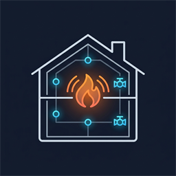
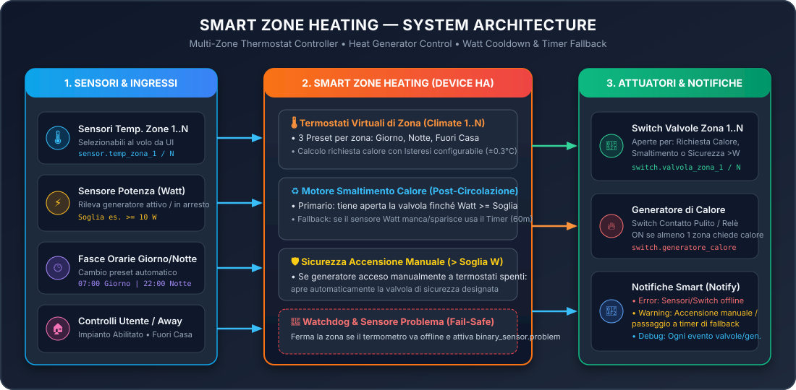

#  Smart Zone Heating for Home Assistant

📖 **Documentazione Completa / Full Documentation:**
* 🇮🇹 **[Manuale Completo in Italiano (`doc/IT.md`)](doc/IT.md)**
* 🇬🇧 **[Complete English Documentation (`doc/EN.md`)](doc/EN.md)**

---

## 🇮🇹 Panoramica (Italiano)

**Smart Zone Heating** è un'integrazione custom per **Home Assistant** progettata per orchestrare impianti di riscaldamento multi-zona ($1 \dots 10$ zone o piani indipendenti) pilotando le relative **elettrovalvole di zona** e un **Generatore di Calore comune** comandato da relè / contatto pulito (stufe a pellet idro, termocamini, caldaie a biomassa o tradizionali, pompe di calore).

### ✨ Funzionalità Principali
* **Termostati Multi-Zona Nativi (`climate`):** crea automaticamente un termostato per ciascuna zona con modalità `Heat`/`Off` e 3 profili (**Giorno**, **Notte**, **Fuori Casa**).
* **Ciclo Automatico Giorno/Notte e Fuori Casa Globale:** cambio orario automatico con selettori orari dinamici che compaiono sotto l'interruttore **`Giorno/Notte`** solo quando il ciclo è attivo.
* **Smaltimento Calore Intelligente (Monitoraggio Watt + Timer Fallback):** mantiene aperta la valvola di smaltimento finché l'assorbimento elettrico del generatore non scende sotto la soglia in Watt (es. `< 10 W`), usando il timer in minuti come paracadute automatico.
* **Rilevamento Accensione Manuale:** se il consumo in Watt supera la soglia a termostati spenti, apre automaticamente la valvola di sicurezza per far circolare l'acqua.
* **Controllo Esclusivo degli Switch:** se attivo, nasconde gli switch fisici dalla dashboard di Home Assistant e annulla istantaneamente qualsiasi modifica manuale non conforme.
* **Diagnostica Live a Colpo d'Occhio:** mostra nel riquadro *Diagnostica* lo stato in tempo reale di tutti i sensori e gli switch selezionati (`Generatore`, `Consumo Generatore`, `Temperatura <Zona>`, `Valvola <Zona>`).
* **Tracciamento Nativo nel Registro Attività (`SZH Integration`) e Notifiche (`Error` / `Warning` / `Debug`).**

### 🛠️ Installazione Rapida (HACS)
1. Apri **HACS** $\rightarrow$ menu in alto a destra $\rightarrow$ **Repository personalizzati**.
2. Aggiungi `https://github.com/pasmimmo/ha-smart-zone-heating` con categoria **Integrazione**.
3. Scarica **Smart Zone Heating**, riavvia Home Assistant e aggiungila da **Impostazioni $\rightarrow$ Dispositivi e servizi $\rightarrow$ Aggiungi integrazione**.

👉 **[Leggi il Manuale Completo in Italiano (`doc/IT.md`)](doc/IT.md)** per la spiegazione dettagliata di tutte schermate, dei controlli dinamici e delle **Impostazioni Avanzate**.

---

## 🇬🇧 Overview (English)

**Smart Zone Heating** is a custom integration for **Home Assistant** designed to orchestrate multi-zone heating systems ($1 \dots 10$ independent zones or floors) by controlling **motorized zone valves** and a common **Heat Generator** via a dry-contact / relay switch (pellet hydro-stoves, wood thermo-stoves, boilers, heat pumps).

### ✨ Key Features
* **Native Multi-Zone Thermostats (`climate`):** creates a thermostat per zone with `Heat`/`Off` modes and **Day**, **Night**, and **Away** presets.
* **Automatic Day/Night Schedule & Global Away Mode:** automatic hourly transitions with dynamic time pickers appearing right beneath the **`Giorno/Notte`** switch when enabled.
* **Smart Heat Dissipation (Watt Monitoring + Timer Fallback):** keeps a designated cooldown zone valve open after generator shutdown until power draw drops below the Watt threshold (e.g., `< 10 W`), with a configurable fallback timer.
* **Manual Ignition Safety:** if generator power exceeds the threshold while thermostats are off, automatically opens a safety zone valve.
* **Exclusive Switch Control:** hides physical switches from Home Assistant dashboards and immediately reverts manual changes that conflict with the calculated state.
* **At-a-Glance Live Diagnostics:** displays the real-time status of all selected switches and sensors (`Generatore`, `Consumo Generatore`, `Temperatura <Zona>`, `Valvola <Zona>`) in the *Diagnostics* panel.
* **Unified Activity Logbook Attribution (`SZH Integration`) & Multi-Level Notifications (`Error` / `Warning` / `Debug`).**

👉 **[Read the Complete English Documentation (`doc/EN.md`)](doc/EN.md)** for a step-by-step guide to the setup wizard, Device page controls, and **Advanced Settings**.

---

## 🤝 Crediti / Credits

* **Ideazione, architettura impianto e casi d'uso reali:** [@pasmimmo](https://github.com/pasmimmo)
* **Sviluppo in Pair Programming, codice e documentazione:** **Antigravity** *(Google DeepMind)*

## 📄 License

Distributed under the **MIT License**. See [LICENSE](LICENSE) for more information.
