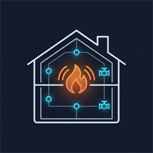
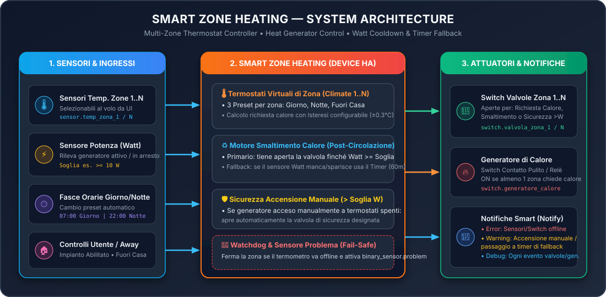

#  Smart Zone Heating for Home Assistant

[](https://github.com/pasmimmo/ha-smart-zone-heating/actions)
[](https://github.com/pasmimmo/ha-smart-zone-heating/releases)
[](https://www.home-assistant.io/)
[](LICENSE)

📖 **Documentazione Completa / Full Documentation:**
* 🇮🇹 **[Manuale Completo in Italiano (`docs/IT.md`)](docs/IT.md)**
* 🇬🇧 **[Complete English Documentation (`docs/EN.md`)](docs/EN.md)**

---

## 🇮🇹 Panoramica (Italiano)

**Smart Zone Heating** è un'integrazione custom per **Home Assistant** progettata per orchestrare impianti di riscaldamento multi-zona ($1 \dots 10$ zone o piani indipendenti) pilotando le relative **elettrovalvole di zona** e un **Generatore di Calore comune** comandato da relè / contatto pulito (stufe a pellet idro, termocamini, caldaie a biomassa o tradizionali, pompe di calore).



### ✨ Funzionalità Principali
* **Termostati Multi-Zona Nativi (`climate`):** crea automaticamente un termostato `[SZH] Termostato <Zona>` per ciascuna zona con modalità `Heat`/`Off` e 3 profili (**Giorno**, **Notte**, **Fuori Casa**).
* **Priorità Idraulica Garantita:** apre le valvole richieste *prima* di accendere il generatore (bloccando l'accensione se tutte le valvole richieste sono indisponibili) e spegne il generatore *prima* di chiudere le valvole.
* **Ciclo Automatico Giorno/Notte e Fuori Casa Globale:** cambio orario automatico con selettori orari dinamici che compaiono sotto l'interruttore **`[SZH] Giorno/Notte`** solo quando il ciclo è attivo.
* **Stima Ciclo Vita Generatore e Smaltimento Calore (Watt + Timer Fallback):** stima la fase operativa del generatore (`Spento`, `In avvio`, `In funzione`, `Smaltimento calore`, `Acceso manualmente`), mantenendo aperta la valvola di smaltimento finché l'assorbimento elettrico non scende sotto la soglia in Watt (es. `< 10 W`) con timer in minuti come paracadute automatico.
* **Rilevamento Accensione Manuale:** se il consumo in Watt supera la soglia a termostati spenti, apre automaticamente la valvola di sicurezza per far circolare l'acqua.
* **Controllo Esclusivo degli Switch:** se attivo, nasconde gli switch fisici dalla dashboard di Home Assistant e annulla istantaneamente qualsiasi modifica manuale non conforme.
* **Nomi Entità Standardizzati (`[SZH] <Nome>`) e Diagnostica Live:** tutte le entità create dall'integrazione hanno il prefisso `[SZH]` (`[SZH] Generatore`, `[SZH] Consumo Generatore`, `[SZH] Temperatura <Zona>`, `[SZH] Valvola <Zona>`, `[SZH] Stato Sistema`) per trovarle subito in Home Assistant.
* **Tracciamento Nativo nel Registro Attività (`SZH`) e Notifiche Strutturate (`Status` / `Reason` / `Value`) con Friendly Name.**

### 🛠️ Installazione Rapida (HACS)
1. Apri **HACS** $\rightarrow$ menu in alto a destra $\rightarrow$ **Repository personalizzati**.
2. Aggiungi `https://github.com/pasmimmo/ha-smart-zone-heating` con categoria **Integrazione**.
3. Scarica **Smart Zone Heating**, riavvia Home Assistant e aggiungila da **Impostazioni $\rightarrow$ Dispositivi e servizi $\rightarrow$ Aggiungi integrazione**.

👉 **[Leggi il Manuale Completo in Italiano (`docs/IT.md`)](docs/IT.md)** per la spiegazione dettagliata di tutte le schermate, dei controlli dinamici e delle **Impostazioni Avanzate**.

---

## 🇬🇧 Overview (English)

**Smart Zone Heating** is a custom integration for **Home Assistant** designed to orchestrate multi-zone heating systems ($1 \dots 10$ independent zones or floors) by controlling **motorized zone valves** and a common **Heat Generator** via a dry-contact / relay switch (pellet hydro-stoves, wood thermo-stoves, boilers, heat pumps).

### ✨ Key Features
* **Native Multi-Zone Thermostats (`climate`):** creates a `[SZH] Termostato <Zone>` entity per zone with `Heat`/`Off` modes and **Day**, **Night**, and **Away** presets.
* **Hydraulically Safe Actuation Ordering:** opens required zone valves *before* turning on the heat generator and turns off the heat generator *before* closing zone valves.
* **Automatic Day/Night Schedule & Global Away Mode:** automatic hourly transitions with dynamic time pickers appearing right beneath the **`[SZH] Giorno/Notte`** switch when enabled.
* **Generator Lifecycle Estimation & Smart Heat Dissipation (Watt + Timer Fallback):** tracks generator phases (`OFF`, `STARTING`, `RUNNING`, `STOPPING_COOLDOWN`, `MANUAL_OVERRIDE`) and keeps a designated cooldown zone valve open after shutdown until power draw drops below the Watt threshold, with a configurable fallback timer.
* **Manual Ignition Safety:** if generator power exceeds the threshold while thermostats are off, automatically opens a safety zone valve.
* **Exclusive Switch Control:** hides physical switches from Home Assistant dashboards and immediately reverts manual changes that conflict with the calculated state.
* **Standardized `[SZH]` Entity Naming & Live Diagnostics:** all integration entities use the `[SZH]` prefix (`[SZH] Generatore`, `[SZH] Consumo Generatore`, `[SZH] Temperatura <Zone>`, `[SZH] Valvola <Zone>`) in the *Diagnostics* panel.
* **Unified Activity Logbook Attribution (`SZH`) & Structured Friendly-Name Notifications (`Status` / `Reason` / `Value`).**

👉 **[Read the Complete English Documentation (`docs/EN.md`)](docs/EN.md)** for a step-by-step guide to the setup wizard, Device page controls, and **Advanced Settings**.

---

## 💻 Sviluppo, Modifica e Test in Locale (Local Development)

Nella cartella isolata [`.dev-tools/`](.dev-tools/README.md) *(ignorata da HACS durante l'installazione utente, che scarica solo `custom_components/smart_zone_heating`)* è presente l'ambiente completo per sviluppare, modificare e testare l'integrazione su **Home Assistant 2026.11.0** (Python 3.14) tramite Docker, senza installare dipendenze sulla macchina host.

### 1. Eseguire i test automatici e il linter (`pytest` + `ruff`)
```powershell
docker compose -f .dev-tools/docker-compose.test.yml run --rm test-runner
```
Questo comando compila tutti i moduli Python, esegue il linter **Ruff** e lancia i **16 scenari di test end-to-end** (configurazione, persistenza al riavvio, indisponibilità sensori/valvole, Piano 1, Piano 2, entrambi i piani con handover, notifiche `[SZH]`, ciclo vita generatore e accensione manuale).

### 2. Avviare Home Assistant Live da Browser (`http://localhost:8123`)
Per testare manualmente l'integrazione da Chrome con dispositivi simulati già configurati (3 switch relè, 2 slider temperatura e 1 slider potenza Watt definiti in `.dev-tools/sandbox/config/configuration.yaml`):
```powershell
docker compose -f .dev-tools/docker-compose.test.yml --profile sandbox up -d ha-sandbox
```
* Apri **`http://localhost:8123`** nel browser.
* La cartella `custom_components/smart_zone_heating` è montata in live-reload: dopo aver modificato il codice Python ti basta eseguire:
  ```powershell
  docker restart ha-smart-zone-test
  ```
* Per fermare il container live al termine delle prove:
  ```powershell
  docker compose -f .dev-tools/docker-compose.test.yml --profile sandbox down
  ```

---

## 🤝 Crediti / Credits

* **Ideazione, architettura impianto e casi d'uso reali:** [@pasmimmo](https://github.com/pasmimmo)
* **Sviluppo in Pair Programming, codice e documentazione:** **Antigravity** *(Google DeepMind)*

## 📄 License

Distributed under the **MIT License**. See [LICENSE](LICENSE) for more information.
