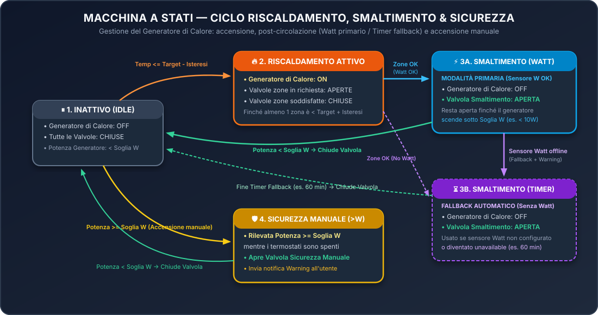

# 🇬🇧 Smart Zone Heating — Complete Documentation (English)

**[⬅️ Back to Main README](../README.md)** | **[🇮🇹 Leggi in Italiano](IT.md)**

---

## 📑 Table of Contents

1. [Overview & Real-World Use Case](#-1-overview--real-world-use-case)
2. [How the Internal State Machine Works](#-2-how-the-internal-state-machine-works)
3. [Installation (HACS / Marketplace & Manual)](#-3-installation-hacs--marketplace--manual)
4. [Initial Setup Wizard](#-4-initial-setup-wizard)
5. [Device Page Guide (Controls, Configuration, Diagnostics)](#-5-device-page-guide-controls-configuration-diagnostics)
6. [Advanced Settings (Gear Menu `Configure`)](#-6-advanced-settings-gear-menu-configure)
7. [Exclusive Switch Control](#-7-exclusive-switch-control)
8. [Activity Logbook & Notification System](#-8-activity-logbook--notification-system)

---

## 💡 1. Overview & Real-World Use Case

**Smart Zone Heating** (`smart_zone_heating`) is a custom integration for **Home Assistant** designed to orchestrate multi-zone heating systems ($1 \dots 10$ independent thermal zones or floors) equipped with **motorized zone valves** and a common **Heat Generator** controlled via a dry-contact / relay switch (pellet hydro-stoves, wood thermo-stoves, biomass boilers, traditional boilers, heat pumps).

### Why Standard Home Assistant Thermostats Are Not Enough
When using a heat generator with **thermal inertia** (such as a hydro-stove or boiler with post-circulation):
1. Once all rooms reach target temperature and the relay switch turns off the generator, the generator does not stop producing heat immediately—it takes several minutes to extinguish the flame and cool down the heat exchanger.
2. If all zone valves closed immediately upon reaching target temperature, the circulation pump would push against a closed hydraulic circuit, causing **overheating and safety lockouts**.
3. Similarly, if someone turns on the heat generator **manually from its physical control panel** while Home Assistant thermostats are idle, a safety mechanism must detect the electrical power draw (in Watts) and immediately open a relief zone valve.

**Smart Zone Heating** solves all of this natively inside **a single Home Assistant Device**, eliminating fragile `input_boolean` helpers and complex YAML automations.

---

## ⚙️ 2. How the Internal State Machine Works

The integration continuously evaluates all zones and the heat generator across **4 operating phases** (displayed in the **`Stato Sistema`** / System State diagnostic sensor):

### Phase A — Active Heating
* Each zone compares its room temperature sensor against its target temperature ($\pm$ **Hysteresis**):
  * **Heat demand ON:** when $T_{\text{current}} \le T_{\text{target}} - \text{Hysteresis}$.
  * **Heat demand OFF:** when $T_{\text{current}} \ge T_{\text{target}} + \text{Hysteresis}$.
* When **at least one zone** demands heat:
  * Only the demanding zones' valves are opened.
  * The common **Heat Generator** switch is turned `ON`.

### Phase B — Residual Heat Dissipation / Cooldown
* As soon as **all zones** are satisfied (transition from *at least one active zone* to *no active zones*):
  1. The **Heat Generator** switch turns `OFF`.
  2. If **Residual Heat Dissipation (`cooldown_enabled`)** is enabled, the integration keeps the designated **Heat Dissipation Zone Valve** open to circulate and dissipate residual hot water.
  3. **How does it decide when to close the dissipation valve?**
     * **Watt Monitoring Enabled (Primary):** after an initial stabilization delay (`power_grace_seconds`, default `15 s`), the valve remains open as long as generator power consumption is $\ge$ **Operating Threshold in Watts** (e.g., `10 W`). As soon as power drops below the threshold ($< 10\text{ W}$), the generator has completed its shutdown cycle and the valve closes immediately.
     * **Closing Timer / Fallback:** if Watt monitoring is disabled—or if the smart plug becomes `unavailable` during cooldown—the valve remains open for the configured **Closing Timer (minutes)** (default `60 min`, visible via **`Timer Smaltimento`**) and then closes safely.

### Phase C — Manual Ignition Safety
* If no zone is calling for heat and the system is not in cooldown, but the Watt sensor detects power consumption $\ge$ **Operating Threshold in Watts** (e.g., someone turned on the stove manually from its physical panel):
  * The integration automatically opens the **Manual Ignition Safety Valve** (either the same valve used for heat dissipation or a dedicated zone) and sends a **Warning** notification.
  * Once power drops back below the threshold, the valve closes.

### Phase D — Sensor Fail-Safe
* If a zone's temperature sensor becomes `unavailable` or `unknown`, that zone safely stops requesting heat, the **`Problema Sensori`** binary sensor turns ON (`Problem`), and an **Error** notification is sent.

---

## 🛠️ 3. Installation (HACS / Marketplace & Manual)

### Option 1: Via HACS or Home Assistant Marketplace (Recommended)
1. Open **HACS** (or **Settings $\rightarrow$ Marketplace** in Home Assistant 2026.11+).
2. Click the 3 dots in the top-right corner $\rightarrow$ **Custom repositories**.
3. Enter `https://github.com/pasmimmo/ha-smart-zone-heating` and select **Integration**.
4. Download **Smart Zone Heating** and **restart Home Assistant**.

### Option 2: Manual Installation
1. Copy the `custom_components/smart_zone_heating` folder into `/config/custom_components/smart_zone_heating` of your Home Assistant instance.
2. **Restart Home Assistant**.

---

## 🧙‍♂️ 4. Initial Setup Wizard

Go to **Settings $\rightarrow$ Devices & Services $\rightarrow$ Add Integration** and search for **Smart Zone Heating**:

1. **Step 1 — Thermostats and Zones Setup:**
   * **System name** (e.g., *Home Heating*).
   * **Number of thermal zones** ($1 \dots 10$).
   * **Thermostat hysteresis (°C)** (default `0.3 °C`).
   * **Enable automatic Day / Night schedule** (if enabled, opens **Step 1b** to choose Day and Night start times).
2. **Step 2 — Zone Thermostat $1 \dots N$ (repeated for each zone):**
   * **Zone name** (e.g., *Floor 1*, *Floor 2*, *Living Area*).
   * **Zone valve switch** (`switch.*` controlling the motorized valve).
   * **Room temperature sensor** (`sensor.*` reading room temperature).
   * **Preset temperatures (°C)** for **Day**, **Night**, and **Away**.
3. **Step 3 — Advanced Settings (Heat Generator, Dissipation & Safety):**
   * Follows the multi-page flow described in [Section 6](#-6-advanced-settings-gear-menu-configure).

---

## 📱 5. Device Page Guide (Controls, Configuration, Diagnostics)

Under **Settings $\rightarrow$ Devices & Services $\rightarrow$ Smart Zone Heating**, all entities are organized into **3 clean sections**:

### 🎛️ `Controls` (Daily Use)
Ordered by priority:
1. **`Termostato <Zone>` (`climate`)** *(top items)*
   * Native Home Assistant thermostat for each zone with `Heat` / `Off` modes and **Day**, **Night**, **Away** presets.
2. **`Attiva Termostati` (`switch`)** *(Enable Thermostats)*
   * Master switch bidirectionally synced with zone thermostats: turning it OFF sets all zone thermostats to `Off`; turning it ON sets them all back to `Heat`.
3. **`Fuori Casa` (`switch`)** *(Away Mode)*
   * One-click global **Away** mode across all zones.
4. **`Giorno/Notte` (`switch`)** *(Day/Night Schedule)*
   * Enables or disables automatic hourly switching between **Day** and **Night** presets.
   * **Dynamic behavior:** when **`Giorno/Notte`** is turned ON, two time pickers dynamically appear **immediately below it**:
     * **`Giorno/Notte: Ora Giorno` (`time`)** *(Day Start Time)*
     * **`Giorno/Notte: Ora Notte` (`time`)** *(Night Start Time)*
     When **`Giorno/Notte`** is turned OFF, both time pickers automatically disappear to keep the UI clean.

---

### 🔧 `Configuration` (Quick Tuning)
1. **`Isteresi` (`number`)** *(Hysteresis)*
   * Temperature tolerance in `°C` (`0.1 °C` to `2.0 °C`, default `0.3 °C`).
2. **`Sensore <Zone>` (`select`)** *(Zone Temperature Sensor)*
   * Dropdown to switch on the fly which room temperature sensor drives each zone without restarting Home Assistant.
3. **`Notifiche` (`select`)** *(Notifications)*
   * Selects the `notify.*` service for alerts (or `Disabilitate` / Disabled).
   * **Dynamic behavior:** when a notification service is selected, **`Notifiche: Livello` (`select`)** *(Notification Level: `Error`, `Warning`, `Debug`)* dynamically appears **immediately below it**.

---

### 🩺 `Diagnostics` (At-a-Glance Live Status)
Displays both the system operating state and **the live state of all selected sensors and switches** in one place (ideal when Exclusive Control hides the physical switches from Lovelace dashboards):

| Entity | Type | Live Information Displayed |
| :--- | :--- | :--- |
| **`Stato Sistema`** | `sensor` | Current operating phase (*Idle*, *Heating*, *Cooldown Watt/Timer*, *Manual Safety*). |
| **`Problema Sensori`** | `binary_sensor` | `OK` when all entities are healthy; `Problem` if any switch/sensor is `unavailable` (listed in attributes). |
| **`Timer Smaltimento`** | `sensor` | Remaining minutes of the cooldown timer *(shown when heat dissipation is enabled)*. |
| **`Generatore`** | `sensor` | Live state of the selected heat generator switch (**`ON`** / **`OFF`** / **`Indisponibile`**) + `source_entity` attribute. |
| **`Consumo Generatore`** | `sensor` | Live power draw in **`W`** from the selected power sensor *(shown when Watt monitoring is enabled)*. |
| **`Temperatura <Zone>`** | `sensor` | Live room temperature in **`°C`** from the sensor currently selected for each zone. |
| **`Valvola <Zone>`** | `sensor` | Live state of each zone's valve switch (**`ON`** / **`OFF`** / **`Indisponibile`**) + forced-open reason in attributes. |

---

## ⚙️ 6. Advanced Settings (Gear Menu `Configure`)

Clicking the **gear icon (`Configure`)** on the Device page launches the **Advanced Settings** multi-page wizard, with a 1–2 line explanation under every field:

1. **Page 1 — `Advanced Settings — 1. Heat Generator & Dissipation`**
   * **Common heat generator switch** (`heater_entity`): selects the dry-contact / relay switch controlling the main heat generator.
   * **Exclusive switch control** (`exclusive_control` Yes/No): hides physical switches in Home Assistant and immediately reverts manual state changes.
   * **Enable residual heat dissipation** (`cooldown_enabled` Yes/No): keeps a zone valve open after generator shutdown to dissipate residual heat.
     * 👉 *If **No**: saves and closes immediately.*
     * 👉 *If **Yes**: proceeds to **Page 2**.*
2. **Page 2 *(if `Enable residual heat dissipation` = Yes)* — `Advanced Settings — 2. Heat Dissipation`**
   * **Heat dissipation zone valve** (`cooldown_zone_id`): which zone valve to keep open after shutdown.
   * **Use Watt monitoring sensor to detect generator operating state** (`use_power_sensor` Yes/No): uses a power sensor (Watts) to close the valve as soon as the generator finishes shutting down.
   * **Closing timer (minutes)** (`cooldown_minutes`): valve opening duration in minutes (used as a safety fallback if Watt monitoring is enabled).
     * 👉 *If `Use Watt monitoring sensor` is **No**: saves and closes immediately.*
     * 👉 *If `Use Watt monitoring sensor` is **Yes**: proceeds to **Page 2.1**.*
3. **Page 2.1 *(if `Use Watt monitoring sensor` = Yes)* — `Advanced Settings — 2.1 Watt Monitoring`**
   * **Power sensor (Watts)** (`power_sensor`): smart plug / Watt sensor measuring the electrical power draw of the heat generator.
   * **Operating threshold in Watts** (`power_threshold_watt`, default `10 W`): above this threshold the generator is considered active; below it, off.
   * **Reading stabilization delay (seconds)** (`power_grace_seconds`, default `15 s`): initial wait time in seconds after shutdown before checking Watts.
     * 👉 *Proceeds to **Page 3**.*
4. **Page 3 *(only available when a Watt sensor is configured)* — `Advanced Settings — 3. Manual Ignition Detection`**
   * **Enable manual ignition detection** (`manual_safety_enabled` Yes/No): opens a safety valve automatically if power draw exceeds the Watt threshold while thermostats are idle.
   * **Use a different zone valve for manual ignition** (`use_separate_manual_zone` Yes/No): if **Yes**, opens **Page 3.1 (`Manual Ignition Safety Valve`)** to select the dedicated zone valve.

---

## 🔒 7. Exclusive Switch Control

* **Enabled (`ON`):** physical switches (generator + zone valves) are automatically hidden from Home Assistant dashboards (`hidden_by: integration`) and any manual toggle that conflicts with the integration's state is immediately reverted and logged.
* **Disabled (`OFF`):** physical switches remain visible and the integration operates in *edge-triggered* mode, only sending commands when the calculated state changes.

---

## 📜 8. Activity Logbook & Notification System

Every action uses a unified, human-readable format across both the **Home Assistant Logbook** and **Notifications**:

* **Entity Logbook / History:**
  * `SZH Integration: -> on, Termostato Piano 1 18,5<22`
  * `SZH Integration: -> off, nessuna richiesta (22>=22)`
  * `SZH Integration: -> on, smaltimento calore (85W>=10W)`
  * `SZH Integration: ripristino stato, Termostato Piano 1 off (controllo esclusivo)`
* **Notifications (`Error` / `Warning` / `Debug`):**
  * `[SZH Integration] switch.valvola_zona_piano_1 -> on, Termostato Piano 1 18,5<22`
  * `[SZH Integration] number.riscaldamento_casa_isteresi_termostati -> 0,5°C (precedente: 0,3°C)`
