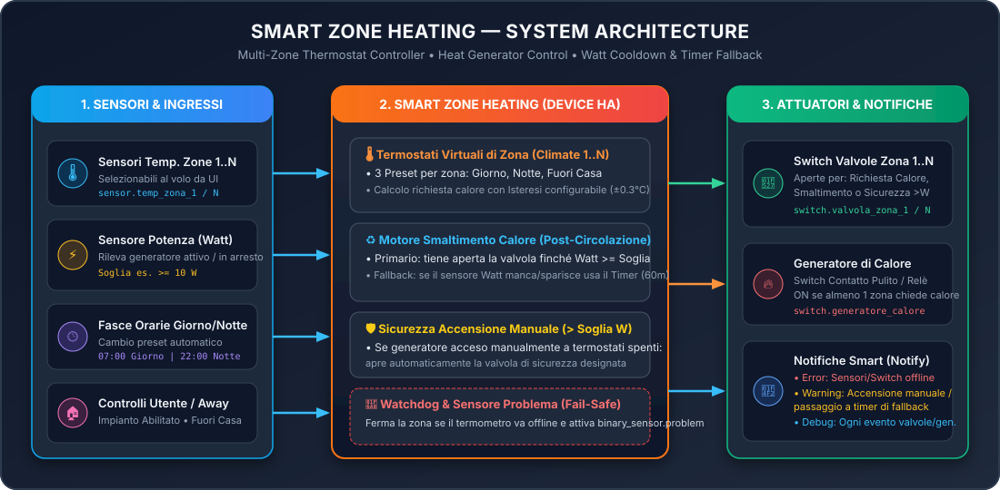
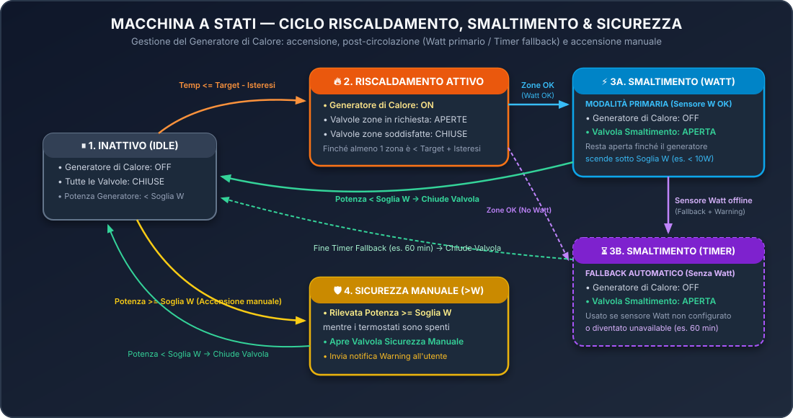

# 🇬🇧 Smart Zone Heating — Complete Documentation (English)

**[⬅️ Back to Main README](../README.md)** | **[🇮🇹 Leggi in Italiano](IT.md)**

---

## 📑 Table of Contents

1. [Overview & Real-World Use Case](#-1-overview--real-world-use-case)
2. [How the Internal State Machine & Generator Lifecycle Work](#-2-how-the-internal-state-machine--generator-lifecycle-work)
3. [Installation (HACS / Marketplace & Manual)](#-3-installation-hacs--marketplace--manual)
4. [Initial Setup Wizard](#-4-initial-setup-wizard)
5. [Device Page Guide (Controls, Configuration, Diagnostics)](#-5-device-page-guide-controls-configuration-diagnostics)
6. [Advanced Settings (Gear Menu `Configure`)](#-6-advanced-settings-gear-menu-configure)
7. [Exclusive Switch Control](#-7-exclusive-switch-control)
8. [Activity Logbook & Notification System](#-8-activity-logbook--notification-system)
9. [Local Development, Editing & Testing](#-9-local-development-editing--testing)

---

## 💡 1. Overview & Real-World Use Case

**Smart Zone Heating** (`smart_zone_heating`) is a custom integration for **Home Assistant** designed to orchestrate multi-zone heating systems ($1 \dots 10$ independent thermal zones or floors) equipped with **motorized zone valves** and a common **Heat Generator** controlled via a dry-contact / relay switch (pellet hydro-stoves, wood thermo-stoves, biomass boilers, traditional boilers, heat pumps).

### Why Standard Home Assistant Thermostats Are Not Enough
When using a heat generator with **thermal inertia** (such as a hydro-stove or boiler with post-circulation):
1. Once all rooms reach target temperature and the relay switch turns off the generator, the generator does not stop producing heat immediately—it takes several minutes to extinguish the flame and cool down the heat exchanger.
2. If all zone valves closed immediately upon reaching target temperature, the circulation pump would push against a closed hydraulic circuit, causing **overheating and safety lockouts**.
3. Similarly, if someone turns on the heat generator **manually from its physical control panel** while Home Assistant thermostats are idle, a safety mechanism must detect the electrical power draw (in Watts) and immediately open a relief zone valve.

**Smart Zone Heating** solves all of this natively inside **a single Home Assistant Device**, with hydraulically safe actuation ordering and standardized **`[SZH]`** entity prefixes.

---

## ⚙️ 2. How the Internal State Machine & Generator Lifecycle Work



The integration continuously evaluates all zones and the heat generator across **4 operating phases** (displayed in the **`[SZH] Stato Sistema`** diagnostic sensor) and estimates the generator lifecycle in [`generator_lifecycle.py`](../custom_components/smart_zone_heating/generator_lifecycle.py) (`OFF`, `STARTING`, `RUNNING`, `STOPPING_COOLDOWN`, `MANUAL_OVERRIDE`):



### Phase A — Active Heating
* Each zone compares its room temperature sensor against its target temperature ($\pm$ **Hysteresis**):
  * **Heat demand ON:** when $T_{\text{current}} \le T_{\text{target}} - \text{Hysteresis}$.
  * **Heat demand OFF:** when $T_{\text{current}} \ge T_{\text{target}} + \text{Hysteresis}$.
* When **at least one zone** demands heat:
  1. Required zone valves are opened **first**.
  2. Only if at least one demanding zone valve is available does the integration turn `ON` the common **Heat Generator** switch.

### Phase B — Residual Heat Dissipation / Cooldown
* As soon as **all zones** are satisfied (transition from *at least one active zone* to *no active zones*):
  1. The **Heat Generator** switch turns `OFF` **before** closing any zone valves.
  2. If **Residual Heat Dissipation (`cooldown_enabled`)** is enabled, the integration keeps the designated **Heat Dissipation Zone Valve** open to circulate and dissipate residual hot water.
  3. **How does it decide when to close the dissipation valve?**
     * **Generator Lifecycle via Watt Monitoring (Primary):** after an initial stabilization delay (`power_grace_seconds`, default `15 s`), the valve remains open as long as generator power consumption is $\ge$ **Operating Threshold in Watts** (e.g., `10 W`). As soon as power drops below the threshold ($< 10\text{ W}$), the generator has completed its shutdown cycle and the valve closes immediately.
     * **Closing Timer / Fallback:** if Watt monitoring is disabled—or if the smart plug becomes `unavailable` during cooldown—the valve remains open for the configured **Closing Timer (minutes)** (default `60 min`, visible via **`[SZH] Timer Smaltimento`**) and then closes safely.

### Phase C — Manual Ignition Safety
* If no zone is calling for heat and the system is not in cooldown, but the Watt sensor detects power consumption $\ge$ **Operating Threshold in Watts** (e.g., someone turned on the stove manually from its physical panel):
  * The generator lifecycle transitions to `MANUAL_OVERRIDE`, the integration automatically opens the **Manual Ignition Safety Valve**, and sends a **Warning** notification.
  * Once power drops back below the threshold, the valve closes.

### Phase D — Sensor Fail-Safe
* If a zone's temperature sensor or valve switch becomes `unavailable` or `unknown` for more than 5 seconds (after the startup grace period), that zone safely stops requesting heat, the **`[SZH] Problema Sensori`** binary sensor turns ON (`Problem`), and an **Error** notification is sent.

---

## 🛠️ 3. Installation (HACS / Marketplace & Manual)

### Option 1: Via HACS or Home Assistant Marketplace (Recommended)
1. Open **HACS** (or **Settings $\rightarrow$ Marketplace** in Home Assistant 2026.11+).
2. Click the 3 dots in the top-right corner $\rightarrow$ **Custom repositories**.
3. Enter `https://github.com/pasmimmo/ha-smart-zone-heating` and select **Integration**.
4. Download **Smart Zone Heating** and **restart Home Assistant**.

### Option 2: Manual Installation
1. Copy the `custom_components/smart_zone_heating` folder into `/config/custom_components/smart_zone_heating` of your Home Assistant instance.
2. **Restart Home Assistant**.

---

## 🧙‍♂️ 4. Initial Setup Wizard

Go to **Settings $\rightarrow$ Devices & Services $\rightarrow$ Add Integration** and search for **Smart Zone Heating**:

1. **Step 1 — Thermostats and Zones Setup:**
   * **System name** (e.g., *Home Heating*).
   * **Number of thermal zones** ($1 \dots 10$).
   * **Thermostat hysteresis (°C)** (default `0.3 °C`).
   * **Enable automatic Day / Night schedule** (if enabled, opens **Step 1b** to choose Day and Night start times).
2. **Step 2 — Zone Thermostat $1 \dots N$ (repeated for each zone):**
   * **Zone name** (e.g., *Floor 1*, *Floor 2*, *Living Area*).
   * **Zone valve switch** (`switch.*` controlling the motorized valve).
   * **Room temperature sensor** (`sensor.*` or `input_number.*` reading room temperature).
   * **Preset temperatures (°C)** for **Day**, **Night**, and **Away**.
3. **Step 3 — Advanced Settings (Heat Generator, Dissipation & Lifecycle Estimation):**
   * Follows the multi-page flow described in [Section 6](#-6-advanced-settings-gear-menu-configure).

---

## 📱 5. Device Page Guide (Controls, Configuration, Diagnostics)

Under **Settings $\rightarrow$ Devices & Services $\rightarrow$ Smart Zone Heating**, all entities are prefixed with **`[SZH]`** and organized into **3 clean sections**:

### 🎛️ `Controls` (Daily Use)
1. **`[SZH] Termostato <Zone>` (`climate`)** *(top items)*
   * Native Home Assistant thermostat for each zone with `Heat` / `Off` modes and **Day**, **Night**, **Away** presets.
2. **`[SZH] Attiva Termostati` (`switch`)** *(Enable Thermostats)*
   * Master switch bidirectionally synced with zone thermostats.
3. **`[SZH] Fuori Casa` (`switch`)** *(Away Mode)*
   * One-click global **Away** mode across all zones.
4. **`[SZH] Giorno/Notte` (`switch`)** *(Day/Night Schedule)*
   * Enables or disables automatic hourly switching between **Day** and **Night** presets.
   * **Dynamic behavior:** when **`[SZH] Giorno/Notte`** is turned ON, two time pickers dynamically appear **immediately below it**:
     * **`[SZH] Giorno/Notte: Ora Giorno` (`time`)**
     * **`[SZH] Giorno/Notte: Ora Notte` (`time`)**

---

### 🔧 `Configuration` (Quick Tuning)
1. **`[SZH] Isteresi` (`number`)** *(Hysteresis)*
   * Temperature tolerance in `°C` (`0.1 °C` to `2.0 °C`, default `0.3 °C`).
2. **`[SZH] Sensore <Zone>` (`select`)** *(Zone Temperature Sensor)*
   * Dropdown to switch on the fly which room temperature sensor drives each zone.
3. **`[SZH] Notifiche` (`select`)** *(Notifications)*
   * Selects the `notify.*` service for alerts (or `Disabilitate` / Disabled).
   * **Dynamic behavior:** when a notification service is selected, **`[SZH] Notifiche: Livello` (`select`)** (`Error`, `Warning`, `Debug`) dynamically appears **immediately below it**.

---

### 🩺 `Diagnostics` (At-a-Glance Live Status)

| Entity | Type | Live Information Displayed |
| :--- | :--- | :--- |
| **`[SZH] Stato Sistema`** | `sensor` | Current operating phase (*Idle*, *Heating*, *Cooldown Watt/Timer*, *Manual Safety*). |
| **`[SZH] Problema Sensori`** | `binary_sensor` | `OK` when all entities are healthy; `Problem` if any switch/sensor is `unavailable` (listed in attributes). |
| **`[SZH] Timer Smaltimento`** | `sensor` | Remaining minutes of the cooldown timer *(shown when heat dissipation is enabled)*. |
| **`[SZH] Generatore`** | `sensor` | Live state of the selected heat generator switch (**`ON`** / **`OFF`** / **`Indisponibile`**) + `generator_phase` attribute. |
| **`[SZH] Consumo Generatore`** | `sensor` | Live power draw in **`W`** from the selected power sensor *(shown when Watt monitoring is enabled)*. |
| **`[SZH] Temperatura <Zone>`** | `sensor` | Live room temperature in **`°C`** from the sensor currently selected for each zone. |
| **`[SZH] Valvola <Zone>`** | `sensor` | Live state of each zone's valve switch (**`ON`** / **`OFF`** / **`Indisponibile`**) + forced-open reason in attributes. |

---

## ⚙️ 6. Advanced Settings (Gear Menu `Configure`)

Clicking the **gear icon (`Configure`)** on the Device page launches the **Advanced Settings** multi-page wizard:

1. **Page 1 — `Advanced Settings — 1. Heat Generator & Dissipation`**
   * **Common heat generator switch** (`heater_entity`): selects the dry-contact / relay switch controlling the main heat generator.
   * **Exclusive switch control** (`exclusive_control` Yes/No): hides physical switches in Home Assistant and immediately reverts manual state changes.
   * **Enable residual heat dissipation** (`cooldown_enabled` Yes/No): keeps a zone valve open after generator shutdown to dissipate residual heat.
2. **Page 2 *(if `Enable residual heat dissipation` = Yes)* — `Advanced Settings — 2. Generator Lifecycle Estimation`**
   * **Heat dissipation zone valve** (`cooldown_zone_id`): which zone valve to keep open after shutdown.
   * **Estimate generator lifecycle via power sensor (Watts)** (`use_power_sensor` Yes/No): estimates when the generator is starting, running, or shutting down based on electrical power draw.
   * **Fallback closing timer (minutes)** (`cooldown_minutes`): valve opening duration in minutes (used as a safety fallback if Watt monitoring is enabled).
3. **Page 2.1 *(if `Estimate generator lifecycle via Watts` = Yes)* — `Advanced Settings — 2.1 Generator Lifecycle Parameters (Watts)`**
   * **Generator power sensor (Watts)** (`power_sensor`): smart plug / Watt sensor measuring the electrical power draw of the heat generator.
   * **Generator running threshold (Watts)** (`power_threshold_watt`, default `10 W`): above this threshold the generator is considered running; below it, off.
   * **Reading stabilization delay (seconds)** (`power_grace_seconds`, default `15 s`): initial wait time in seconds after shutdown before checking Watts.
4. **Page 3 *(only available when a Watt sensor is configured)* — `Advanced Settings — 3. Manual Ignition Detection`**
   * **Enable manual ignition detection** (`manual_safety_enabled` Yes/No): opens a safety valve automatically if power draw exceeds the Watt threshold while thermostats are idle.
   * **Use a different zone valve for manual ignition** (`use_separate_manual_zone` Yes/No): if **Yes**, opens **Page 3.1 (`Manual Ignition Safety Valve`)** to select the dedicated zone valve.

---

## 🔒 7. Exclusive Switch Control

* **Enabled (`ON`):** physical switches (generator + zone valves) are automatically hidden from Home Assistant dashboards (`hidden_by: integration`) and any manual toggle that conflicts with the integration's state is immediately reverted and logged. When the integration is uninstalled or Exclusive Control is disabled, all physical switches are automatically unhidden and released.
* **Disabled (`OFF`):** physical switches remain visible and the integration operates in *edge-triggered* mode, only sending commands when the calculated state changes.

---

## 📜 8. Activity Logbook & Notification System

Every event uses the entity's **Friendly Name** across both the **Home Assistant Logbook (`SZH`)** and **Notifications**:

* **Entity Logbook / History:**
  * `SZH: Valvola Zona Piano 1 -> on, Termostato Piano 1 (18.5<21.0)`
  * `SZH: Valvola Zona Piano 2 -> off, nessuna richiesta (21.5>=19.5)`
  * `SZH: Valvola Zona Piano 1 -> on, smaltimento calore (85W>=10W)`
  * `SZH: Stufa (Contatto Pulito) -> off, ripristino stato (controllo esclusivo)`
* **Notifications (`Error` / `Warning` / `Debug`):**
  Structured with clear `Status:`, `Reason:`, and `Value:` lines:
  ```text
  ℹ️[SZH] - nessuna richiesta
  [DEBUG] Status: Valvola Zona Piano 2 -> off,
  [DEBUG] Reason: nessuna richiesta
  [DEBUG] Value: 21.5>=19.5
  ```

---

## 💻 9. Local Development, Editing & Testing

The isolated [`.dev-tools/`](../.dev-tools/README.md) directory in the repository *(ignored by HACS during end-user installation, as HACS only downloads `custom_components/smart_zone_heating`)* provides a full Dockerized test and sandbox environment running **Home Assistant 2026.11.0** (Python 3.14).

### A. Run Automated Tests & Linter (`pytest` + `ruff`)
```powershell
docker compose -f .dev-tools/docker-compose.test.yml run --rm test-runner
```

### B. Launch Live Home Assistant Instance in Browser (`http://localhost:8123`)
1. Start the sandbox container:
   ```powershell
   docker compose -f .dev-tools/docker-compose.test.yml --profile sandbox up -d ha-sandbox
   ```
2. Open **`http://localhost:8123`** in Chrome.
3. Edit any file under `custom_components/smart_zone_heating/` and reload immediately with:
   ```powershell
   docker restart ha-smart-zone-test
   ```
4. Stop the sandbox when finished:
   ```powershell
   docker compose -f .dev-tools/docker-compose.test.yml --profile sandbox down
   ```
