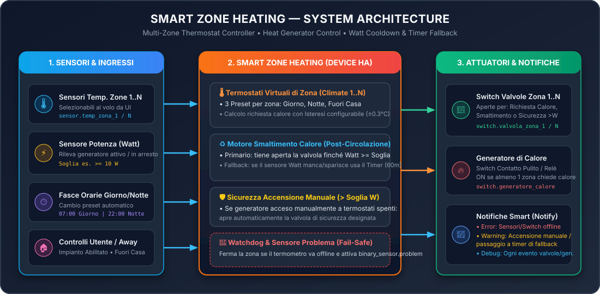
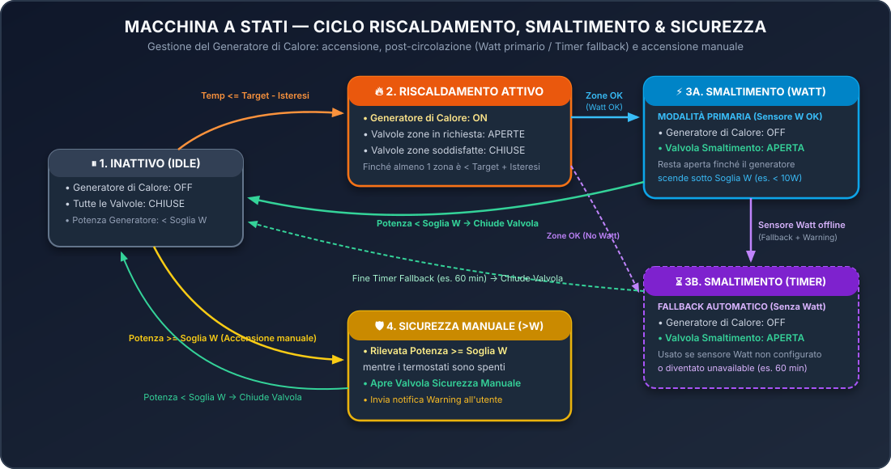

# 🇮🇹 Smart Zone Heating — Manuale Completo (Italiano)

**[⬅️ Torna al README principale](../README.md)** | **[🇬🇧 Read in English](EN.md)**

---

## 📑 Indice

1. [Panoramica e Caso d'Uso Reale](#-1-panoramica-e-caso-duso-reale)
2. [Come Funziona la Logica Interna (Macchina a Stati e Ciclo Vita Generatore)](#-2-come-funziona-la-logica-interna-macchina-a-stati-e-ciclo-vita-generatore)
3. [Installazione (HACS e Manuale)](#-3-installazione-hacs-e-manuale)
4. [Wizard di Prima Configurazione](#-4-wizard-di-prima-configurazione)
5. [Guida alla Pagina Dispositivo (Controlli, Configurazione, Diagnostica)](#-5-guida-alla-pagina-dispositivo-controlli-configurazione-diagnostica)
6. [Impostazioni Avanzate (Menu Ingranaggio `Configura`)](#-6-impostazioni-avanzate-menu-ingranaggio-configura)
7. [Controllo Esclusivo degli Switch](#-7-controllo-esclusivo-degli-switch)
8. [Registro Attività (Logbook) e Sistema di Notifiche](#-8-registro-attività-logbook-e-sistema-di-notifiche)
9. [Sviluppo, Modifica e Test in Locale](#-9-sviluppo-modifica-e-test-in-locale)

---

## 💡 1. Panoramica e Caso d'Uso Reale

**Smart Zone Heating** (`smart_zone_heating`) è un'integrazione custom per **Home Assistant** progettata per orchestrare impianti di riscaldamento multi-zona ($1 \dots 10$ zone o piani indipendenti) dotati di **elettrovalvole di zona** e di un **Generatore di Calore comune** comandato da relè / contatto pulito (stufe a pellet idro, termocamini, caldaie a biomassa o tradizionali, pompe di calore).

### Perché i normali termostati di Home Assistant non bastano?
Nei generatori con **inerzia termica** (come una stufa idro o una caldaia con ciclo di post-circolazione), quando tutte le stanze raggiungono la temperatura target e il contatto pulito spegne il generatore:
1. Il generatore non si arresta istantaneamente, ma impiega diversi minuti per spegnere la fiamma e raffreddare lo scambiatore.
2. Se tutte le valvole di zona si chiudessero subito al raggiungimento del target, la pompa di circolazione spingerebbe contro un circuito idraulico chiuso, mandando il generatore in **sovratemperatura / blocco di sicurezza**.
3. Allo stesso modo, se qualcuno accende il generatore **manualmente dal display fisico** mentre i termostati di Home Assistant sono spenti, serve un'automazione di sicurezza che se ne accorga (leggendo l'assorbimento in Watt) e apra immediatamente una valvola di sfogo.

**Smart Zone Heating** risolve nativamente tutto questo all'interno di **un unico Dispositivo di Home Assistant**, con priorità idraulica garantita e tutte le entità prefissate con **`[SZH]`** per essere subito individuabili.

---

## ⚙️ 2. Come Funziona la Logica Interna (Macchina a Stati e Ciclo Vita Generatore)



L'integrazione valuta continuamente in tempo reale lo stato delle zone e del generatore secondo **4 fasi operative** (visibili nel sensore diagnostico **`[SZH] Stato Sistema`**) e stima il ciclo vita del generatore in [`generator_lifecycle.py`](../custom_components/smart_zone_heating/generator_lifecycle.py) (`Spento`, `In avvio`, `In funzione`, `Smaltimento calore`, `Acceso manualmente`):



### Fase A — Riscaldamento in corso (`Riscaldamento: <Zone>`)
* Ogni zona confronta la temperatura del proprio sensore con la temperatura target ($\pm$ **Isteresi**):
  * **Richiesta calore ON:** quando $T_{\text{attuale}} \le T_{\text{target}} - \text{Isteresi}$.
  * **Richiesta calore OFF:** quando $T_{\text{attuale}} \ge T_{\text{target}} + \text{Isteresi}$.
* Se **almeno una zona** richiede calore:
  1. Vengono aperte **prima** le valvole delle sole zone in richiesta.
  2. Solo se almeno una valvola richiesta è regolarmente disponibile viene acceso lo switch del **Generatore di Calore comune**.

### Fase B — Smaltimento Calore Residuo (`Smaltimento: <Zona>`)
* Non appena **tutte le zone** sono arrivate in temperatura (passaggio da *almeno una zona attiva* a *nessuna zona attiva*):
  1. Lo switch del **Generatore di Calore** viene spento (`OFF`) **prima** di chiudere le valvole.
  2. Se lo **Smaltimento Calore** è abilitato, l'integrazione forza l'apertura della **Valvola di smaltimento calore** designata (es. *Piano 1*) per dissipare il calore residuo dell'acqua.
  3. **Come decide quando chiudere la valvola di smaltimento?**
     * **Con Stima Ciclo Vita via Watt attiva (Primario):** attende i secondi di stabilizzazione iniziale (`power_grace_seconds`, default `15 s`) e mantiene aperta la valvola finché l'assorbimento elettrico del generatore è $\ge$ **Soglia funzionamento in Watt** (es. `10 W`). Appena il consumo scende sotto la soglia ($< 10\text{ W}$), il generatore ha terminato il ciclo di arresto e la valvola viene chiusa subito.
     * **Timer di Chiusura / Fallback:** se il monitoraggio in Watt non è attivo — oppure se la presa smart in Watt diventa `unavailable` durante lo smaltimento — la valvola resta aperta per il tempo impostato in **Temporizzazione chiusura (minuti)** (default `60 min`, monitorabile dal sensore **`[SZH] Timer Smaltimento`**) e poi si chiude in sicurezza.

### Fase C — Sicurezza Accensione Manuale (`Accensione manuale: <Zona>`)
* Se i termostati non stanno chiedendo calore e l'impianto non è in fase di smaltimento, ma il sensore in Watt rileva un assorbimento $\ge$ **Soglia funzionamento in Watt** (es. qualcuno ha acceso la stufa a mano dal pannello fisico):
  * Il ciclo vita del generatore passa in `Acceso manualmente` (`MANUAL_OVERRIDE`), l'integrazione apre automaticamente la **Valvola di sicurezza accensione manuale** e invia una notifica di **Warning**.
  * Quando i Watt tornano sotto la soglia, la valvola viene richiusa.

### Fase D — Protezione Guasti / Fail-Safe (`Problema: <Entità>`)
* Se il sensore di temperatura o la valvola di una zona diventa `unavailable` o `unknown` per oltre 5 secondi (dopo il grace period di avvio), quella zona interrompe per sicurezza la richiesta di calore, si accende il sensore binario **`[SZH] Problema Sensori`** e viene inviata una notifica di **Error**.

---

## 🛠️ 3. Installazione (HACS e Manuale)

### Metodo 1: Tramite HACS (Consigliato)
1. Apri **HACS** in Home Assistant.
2. Clicca sui 3 puntini in alto a destra $\rightarrow$ **Repository personalizzati** (*Custom repositories*).
3. Inserisci `https://github.com/pasmimmo/ha-smart-zone-heating` e seleziona la categoria **Integrazione** (*Integration*).
4. Scarica **Smart Zone Heating** e **riavvia Home Assistant**.

### Metodo 2: Installazione Manuale
1. Copia la cartella `custom_components/smart_zone_heating` dentro `/config/custom_components/smart_zone_heating` della tua istanza Home Assistant.
2. **Riavvia Home Assistant**.

---

## 🧙‍♂️ 4. Wizard di Prima Configurazione

Vai in **Impostazioni $\rightarrow$ Dispositivi e servizi $\rightarrow$ Aggiungi integrazione** e cerca **Smart Zone Heating**:

1. **Passo 1 — Configurazione Termostati e Zone:**
   * **Nome dell'impianto** (es. *Riscaldamento Casa*).
   * **Numero di zone termiche** ($1 \dots 10$).
   * **Isteresi termostati (°C)** (default `0.3 °C`).
   * **Abilita ciclo orario Giorno / Notte** (se attivo, apre il **Passo 1b** per scegliere l'ora di inizio Giorno e l'ora di inizio Notte).
2. **Passo 2 — Termostato Zona $1 \dots N$ (ripetuto per ogni zona):**
   * **Nome della zona** (es. *Piano 1*, *Piano 2*, *Zona Giorno*).
   * **Switch valvola di zona** (`switch.*` che comanda l'elettrovalvola).
   * **Sensore di temperatura** (`sensor.*` o `input_number.*` che legge la temperatura della stanza).
   * **Temperature predefinite (°C)** per i 3 profili: **Giorno**, **Notte** e **Fuori Casa**.
3. **Passo 3 — Impostazioni Avanzate (Generatore, Smaltimento e Stima Ciclo Vita):**
   * Segue lo stesso flusso guidato a pagine descritto nella [Sezione 6](#-6-impostazioni-avanzate-menu-ingranaggio-configura).

---

## 📱 5. Guida alla Pagina Dispositivo (Controlli, Configurazione, Diagnostica)

Aprendo **Impostazioni $\rightarrow$ Dispositivi e servizi $\rightarrow$ Smart Zone Heating**, trovi tutte le entità prefissate con **`[SZH]`** e organizzate in **3 riquadri ordinati**:

### 🎛️ Riquadro `Controlli` (Uso Quotidiano)
1. **`[SZH] Termostato <Zona>` (`climate`)** *(prime voci in alto)*
   * Termostato nativo di Home Assistant per ciascuna zona (`Heat` / `Off` e profili **Giorno**, **Notte**, **Fuori Casa**).
2. **`[SZH] Attiva Termostati` (`switch`)**
   * Interruttore generale sincronizzato bidirezionalmente con i termostati di zona.
3. **`[SZH] Fuori Casa` (`switch`)**
   * Attiva con un solo clic il profilo **Fuori Casa** su tutte le zone; spegnendolo riporta tutte le zone al profilo orario corrente (*Giorno* o *Notte*).
4. **`[SZH] Giorno/Notte` (`switch`)**
   * Abilita o disabilita il cambio automatico di temperatura in base all'orario.
   * **Comportamento dinamico:** quando attivi **`[SZH] Giorno/Notte`**, compaiono **immediatamente sotto** due selettori orari:
     * **`[SZH] Giorno/Notte: Ora Giorno` (`time`)**
     * **`[SZH] Giorno/Notte: Ora Notte` (`time`)**

---

### 🔧 Riquadro `Configurazione` (Parametri Rapidi)
1. **`[SZH] Isteresi` (`number`)**
   * Tolleranza in `°C` (da `0.1 °C` a `2.0 °C`, default `0.3 °C`) prima di accendere o spegnere il riscaldamento.
2. **`[SZH] Sensore <Zona>` (`select`)**
   * Menu a tendina per cambiare al volo quale sensore di temperatura della casa guida ciascuna zona.
3. **`[SZH] Notifiche` (`select`)**
   * Seleziona il servizio `notify.*` su cui ricevere gli avvisi (oppure `Disabilitate`).
   * **Comportamento dinamico:** quando selezioni un servizio diverso da `Disabilitate`, compare **immediatamente sotto** **`[SZH] Notifiche: Livello` (`select`)** (**Error**, **Warning**, **Debug**).

---

### 🩺 Riquadro `Diagnostica` (Stato a Colpo d'Occhio)

| Entità | Tipo | Cosa mostra a colpo d'occhio |
| :--- | :--- | :--- |
| **`[SZH] Stato Sistema`** | `sensor` | Fase corrente con le zone attive (*Inattivo*, *Riscaldamento: Piano 1*, *Smaltimento: Piano 1 (85W)*, *Accensione manuale: Piano 1 (120W)*, *Problema: ...*). |
| **`[SZH] Problema Sensori`** | `binary_sensor` | `OK` se tutti i dispositivi rispondono; `Problema` se uno switch o sensore diventa `unavailable` (elencato negli attributi). |
| **`[SZH] Timer Smaltimento`** | `sensor` | Minuti residui del timer di smaltimento calore *(visibile quando lo smaltimento calore è attivo)*. |
| **`[SZH] Generatore`** | `sensor` | Stato live dello switch del generatore (**`ON`** / **`OFF`** / **`Indisponibile`**) + attributo `ciclo_vita_stimato` (`Spento`, `In avvio`, `In funzione`, `Smaltimento calore`, `Acceso manualmente`). |
| **`[SZH] Consumo Generatore`** | `sensor` | Potenza live in **`W`** letta dal sensore di consumo selezionato *(visibile quando il monitoraggio in Watt è attivo)*. |
| **`[SZH] Temperatura <Zona>`** | `sensor` | Temperatura live in **`°C`** letta dal sensore associato a ciascuna zona. |
| **`[SZH] Valvola <Zona>`** | `sensor` | Stato live dello switch valvola di ciascuna zona (**`ON`** / **`OFF`** / **`Indisponibile`**) + eventuale motivo di apertura forzata negli attributi. |

---

## ⚙️ 6. Impostazioni Avanzate (Menu Ingranaggio `Configura`)

Cliccando sull'icona dell'**ingranaggio (`Configura`)** nella pagina del dispositivo si apre il flusso guidato **Impostazioni Avanzate**:

### 📄 Pagina 1 — `1. Generatore e Smaltimento`
* **Generatore di calore comune** (`heater_entity`): seleziona lo switch (contatto pulito / relè) che comanda il generatore di calore.
* **Controllo esclusivo degli switch** (`exclusive_control` Sì/No): se attivo, nasconde gli switch fisici in Home Assistant e annulla qualsiasi modifica manuale non conforme.
* **Gestisci smaltimento calore** (`cooldown_enabled` Sì/No): se attivo, mantiene aperta una valvola di zona dopo lo spegnimento del generatore per dissipare il calore residuo.

### 📄 Pagina 2 *(se `Gestisci smaltimento calore` = Sì)* — `2. Stima Ciclo Vita Generatore`
* **Valvola di smaltimento calore** (`cooldown_zone_id`): quale valvola di zona mantenere aperta dopo lo spegnimento del generatore.
* **Stima il ciclo vita del generatore tramite sensore di potenza (Watt)** (`use_power_sensor` Sì/No): se attivo, stima quando il generatore è in avvio, in funzione o in arresto leggendo l'assorbimento in Watt.
* **Temporizzazione chiusura paracadute (minuti)** (`cooldown_minutes`): durata apertura valvola in minuti (usata come paracadute automatico se il sensore Watt non è attivo o non risponde).

### 📄 Pagina 2.1 *(se `Stima ciclo vita via Watt` = Sì)* — `2.1 Parametri Ciclo Vita Generatore (Watt)`
* **Sensore potenza generatore (Watt)** (`power_sensor`): il sensore in Watt che misura il consumo elettrico del generatore.
* **Soglia generatore in funzione (Watt)** (`power_threshold_watt`, default `10 W`): sopra questa soglia il generatore è considerato in funzione; sotto questa soglia è considerato spento.
* **Attesa stabilizzazione lettura (secondi)** (`power_grace_seconds`, default `15 s`): secondi di attesa iniziale dopo lo spegnimento prima di verificare i Watt.

### 📄 Pagina 3 *(disponibile solo con Sensore Watt impostato)* — `3. Rilevamento Accensione Manuale`
* **Attiva rilevamento accensione manuale** (`manual_safety_enabled` Sì/No): se il consumo supera la soglia in Watt mentre i termostati sono spenti, apre automaticamente una valvola di sicurezza.
* **Usa una valvola diversa per l'accensione manuale** (`use_separate_manual_zone` Sì/No): se **Sì**, apre la **Pagina 3.1 (`Valvola Accensione Manuale`)** per scegliere la valvola dedicata.

---

## 🔒 7. Controllo Esclusivo degli Switch

* **Quando è ATTIVO (`ON`):**
  1. Gli switch fisici gestiti vengono **nascosti automaticamente** (`hidden_by: integration`) dalle dashboard automatiche di Home Assistant.
  2. Se uno switch fisico viene modificato manualmente in modo non conforme, l'integrazione **lo riporta istantaneamente allo stato calcolato**.
  3. Quando disinstalli l'integrazione o disattivi il Controllo Esclusivo, tutti gli switch fisici vengono **rilasciati e resi nuovamente visibili** automaticamente.
* **Quando è DISATTIVO (`OFF`):**
  1. Gli switch fisici restano visibili normalmente in Home Assistant e l'integrazione opera in modalità *edge-triggered*.

---

## 📜 8. Registro Attività (Logbook) e Sistema di Notifiche

Ogni evento usa il **Friendly Name** dell'entità (mai l'`entity_id` grezzo) sia nel **Registro Attività (`SZH`)** sia nelle **Notifiche**:

* **Nel Registro Attività (Logbook) dell'entità:**
  * `SZH: Valvola Zona Piano 1 -> on, Termostato Piano 1 (18.5<21.0)`
  * `SZH: Valvola Zona Piano 2 -> off, nessuna richiesta (21.5>=19.5)`
  * `SZH: Valvola Zona Piano 1 -> on, smaltimento calore (85W>=10W)`
  * `SZH: Stufa (Contatto Pulito) -> off, ripristino stato (controllo esclusivo)`
* **Nelle Notifiche (`Error` / `Warning` / `Debug`):**
  Ogni notifica è strutturata su 3 righe chiare (`Status`, `Reason`, `Value`):
  ```text
  ℹ️[SZH] - nessuna richiesta
  [DEBUG] Status: Valvola Zona Piano 2 -> off,
  [DEBUG] Reason: nessuna richiesta
  [DEBUG] Value: 21.5>=19.5
  ```
  ```text
  ⚠️[SZH] - accensione manuale rilevata -> apertura sicurezza Piano 1
  [WARN] Status: Sensore Consumo Stufa (W) -> on,
  [WARN] Reason: accensione manuale rilevata -> apertura sicurezza Piano 1
  [WARN] Value: 120W >= 10W
  ```
  ```text
  🚨[SZH] - entità non disponibile
  [ERROR] Status: Sensore Temp Piano 1 -> unavailable,
  [ERROR] Reason: entità non disponibile
  ```

---

## 💻 9. Sviluppo, Modifica e Test in Locale

Nella cartella [`.dev-tools/`](../.dev-tools/README.md) del repository *(non installata da HACS sulle istanze degli utenti finali, poiché HACS scarica solo `custom_components/smart_zone_heating`)* è disponibile l'intero ambiente di test containerizzato su **Home Assistant 2026.11.0** (Python 3.14).

### A. Lanciare tutti i test automatici e il controllo codice (`pytest` + `ruff`)
```powershell
docker compose -f .dev-tools/docker-compose.test.yml run --rm test-runner
```

### B. Lanciare un'istanza Home Assistant Live da Browser (`http://localhost:8123`)
1. Avvia il container sandbox:
   ```powershell
   docker compose -f .dev-tools/docker-compose.test.yml --profile sandbox up -d ha-sandbox
   ```
2. Apri Chrome su **`http://localhost:8123`**: troverai già pronti i 3 switch simulati (`Stufa (Contatto Pulito)`, `Valvola Zona Piano 1`, `Valvola Zona Piano 2`) e i 3 slider (`Sensore Temp Piano 1`, `Sensore Temp Piano 2`, `Sensore Consumo Stufa (W)`).
3. Modifica il codice in `custom_components/smart_zone_heating/` e applica le modifiche al volo con:
   ```powershell
   docker restart ha-smart-zone-test
   ```
4. Ferma l'istanza quando hai terminato:
   ```powershell
   docker compose -f .dev-tools/docker-compose.test.yml --profile sandbox down
   ```
